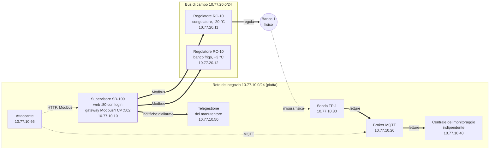

# Threat model del banco di prova

Versione 2.0, 23 novembre 2026. Riferito al banco vulnerabile (`vulnerable/`).

## 1. Scopo e perimetro

Il documento descrive cosa va protetto in un impianto di refrigerazione commerciale connesso, chi lo può attaccare, da dove e con quali effetti. È la base per gli scenari d'attacco del banco vulnerabile e per le contromisure del banco protetto.

Il modello parte dal caso reale descritto nel [case study](../case-study/case_study.pdf): supervisori di refrigerazione raggiungibili dalla rete, con credenziali deboli, modificati usando le loro funzioni previste. Il banco non riproduce un prodotto commerciale ma la **classe di debolezza**. L'SR-100 e l'RC-10 sono dispositivi fittizi.

Fuori perimetro: vulnerabilità del firmware di prodotti reali, attacchi fisici all'impianto, attacchi al personale (phishing, ingegneria sociale), negazione del servizio per saturazione della rete.

## 2. Il sistema modellato

L'architettura segue lo schema tipico di un punto vendita della grande distribuzione.

| Componente | Ruolo | Interfacce | Corrispondente nel caso reale |
|---|---|---|---|
| Regolatori RC-10 | Uno per banco: sonda cablata, termostato, sbrinamento | Modbus sul bus di campo | Regolatori di banco e di cella |
| Supervisore SR-100 | Interroga i regolatori, mostra temperature e parametri, gestisce soglie e allarmi, notifica il manutentore | Web con login (80), gateway Modbus/TCP (502) | Il supervisore di impianto attaccato |
| Telegestione | Riceve le notifiche d'allarme del supervisore | HTTP | Centro di telegestione della ditta di refrigerazione |
| Sonda TP-1, broker, centrale | Monitoraggio indipendente del banco 1, con sonda e allarme propri | MQTT (1883), web della centrale (8080) | Il sistema di monitoraggio che all'EFS ha dato l'allarme |
| Banchi fisici | Modello termico di un congelatore e di un banco frigo | Nessuna, è il "mondo fisico" | Banchi e celle frigorifere |

**Il punto chiave.** Come nella realtà, il supervisore riunisce comando, misura e allarme. Chi lo controlla cambia i parametri e nello stesso tempo decide se l'allarme deve scattare. Il monitoraggio indipendente misura lo stesso banco con una sonda propria e allarma per conto suo, senza passare dal supervisore.

**La simulazione.** I banchi sono modelli termici del primo ordine accelerati di 60 volte: un secondo reale vale un minuto di impianto. Il congelatore sta attorno a -20 °C, il banco frigo attorno a +3 °C, entrambi con sbrinamenti programmati che non fanno scattare allarmi.

**Gli allarmi.**

| Sistema | Regola | Valori di fabbrica (banco 1) |
|---|---|---|
| Supervisore | Temperatura sopra la soglia per il ritardo impostato, poi notifica alla telegestione | -10 °C per 5 minuti simulati |
| Monitoraggio indipendente, allarme | Sopra soglia per 3 letture consecutive, rientra da solo | -10 °C |
| Monitoraggio indipendente, allarme critico | Una sola lettura sopra soglia, resta attivo finché un operatore non lo riconosce | -5 °C |

## 3. Asset e priorità

In un sistema OT l'ordine delle priorità non è quello dell'IT. Viene prima la **safety**, poi la **disponibilità** del processo, poi l'**integrità** di comandi e misure, per ultima la **riservatezza**.

| Asset | Perché conta | Proprietà prioritaria | Danno se compromesso |
|---|---|---|---|
| Merce nei banchi | È il valore economico e sanitario protetto dall'impianto | Safety, disponibilità | Merce da buttare, rischio per la salute se venduta |
| Parametri di controllo (setpoint, durata e temperatura di sbrinamento) | Determinano la temperatura reale | Integrità | Riscaldamento del banco, nel caso reale fino a circa 50 °C e principi d'incendio |
| Soglie e ritardi d'allarme | Decidono se e quando qualcuno viene avvisato | Integrità | Il danno avviene senza che nessuno lo sappia |
| Notifiche alla telegestione | Sono l'unico modo in cui il manutentore viene a sapere del problema di notte | Disponibilità | Nessun intervento fino al mattino |
| Credenziali del supervisore | Proteggono tutte le funzioni precedenti | Riservatezza, integrità | Accesso completo all'impianto |
| Misure del monitoraggio indipendente | Sono la seconda vista sul processo, separata dal supervisore | Integrità, disponibilità | Viene meno l'ultima barriera |
| Dati di processo e documentazione (valori, topic, manuale) | Rivelano struttura, versioni e credenziali di fabbrica | Riservatezza (bassa) | Facilitano la ricognizione |

## 4. Attaccanti

| Profilo | Capacità | Obiettivo | Nel caso reale | Considerato nel banco |
|---|---|---|---|---|
| Opportunistico da Internet | Bassa o media. Motori di ricerca di dispositivi, credenziali di fabbrica, script generici | Danno visibile e propaganda, bersagli scelti tra i meno protetti | Entrambe le ondate, con identità hacktiviste | Sì, è il profilo principale |
| Attore statale sotto identità hacktivista | Alta, ma usa tecniche semplici se bastano | Pressione politica sotto la soglia della guerra | Attribuzione francese della prima ondata all'unità Shahid Kaveh dell'IRGC | Sì, stesse tecniche del precedente |
| Manutentore compromesso (supply chain) | Accesso remoto legittimo all'impianto | Nessuno in proprio, è il canale usato da altri | Ipotesi per l'EFS, attacco passato da un fornitore | Sì, come punto d'ingresso nella rete |
| Insider nel negozio | Accesso fisico e alla rete locale | Sabotaggio, frode | Non osservato | No, fuori perimetro |

**Ipotesi di lavoro.** L'attaccante raggiunge la rete del negozio, perché il supervisore è esposto su Internet come nel caso reale o perché è entrato dall'accesso remoto di un manutentore. Non ha accesso fisico, non conosce credenziali diverse da quelle di fabbrica e non usa vulnerabilità del software. Può leggere la documentazione pubblica del prodotto. Nel banco questa condizione è rappresentata dal container `attaccante` sulla rete del negozio. Il bus di campo non gli è raggiungibile.

## 5. Superficie d'attacco

| Punto d'ingresso | Protocollo e porta | Debolezza nella versione vulnerabile | CWE |
|---|---|---|---|
| Interfaccia web del supervisore | HTTP, 80 | Credenziali di fabbrica uguali su ogni esemplare, documentate nel manuale e mai cambiate | CWE-1392 |
| | | Nessun limite ai tentativi di login, nessun secondo fattore | CWE-307, CWE-308 |
| | | Chiave di firma delle sessioni fissa nel codice | CWE-321 |
| | | Nessun limite di plausibilità su parametri e soglie (soglia d'allarme di +60 °C accettata) | CWE-20 |
| | | Traffico in chiaro, banner con modello e versione | CWE-319, CWE-200 |
| Gateway Modbus/TCP del supervisore | Modbus/TCP, 502 | Il protocollo non prevede autenticazione: chi raggiunge la porta scrive parametri e soglie, anche senza conoscere le credenziali web | CWE-306 |
| Broker MQTT del monitoraggio | MQTT, 1883 | Accesso anonimo, nessuna ACL: chiunque legge e pubblica su ogni topic | CWE-306, CWE-284 |
| | | Traffico in chiaro | CWE-319 |
| Letture della sonda | MQTT, `monitoraggio/banco1/temperatura` | Nessuna firma: la centrale non distingue una lettura vera da una falsa | CWE-345 |
| | | Timestamp e numero di sequenza presenti ma non verificati | CWE-294 |
| Configurazione remota della sonda | MQTT, `monitoraggio/banco1/sonda1/config` | Comandi accettati da chiunque | CWE-306 |
| | | Il messaggio di presentazione "retained" rivela il topic di configurazione | CWE-200 |
| Centrale del monitoraggio | HTTP, 8080 | Nessun heartbeat: l'assenza di letture non genera allarmi | CWE-693 |
| | | Chiunque può riconoscere (cancellare) un allarme | CWE-306 |
| Rete | Tutte | Rete piatta: supervisore, monitoraggio, telegestione e postazioni nello stesso segmento | Nessun CWE specifico, vedi nota |

Nota. La segmentazione di rete non ha un CWE specifico. Nella relazione la si descrive con zone e conduit secondo IEC 62443.

### Sintesi STRIDE

| Componente | S | T | R | I | D | E |
|---|---|---|---|---|---|---|
| Supervisore | Chiunque entra come "installatore" con le credenziali del manuale | Parametri e soglie modificati | Il registro mostra l'utente condiviso "installatore", o solo "gateway modbus" | Modello, versione e mappa dei registri pubblici | Sbrinamento forzato blocca il raffreddamento | Un solo ruolo, con tutti i permessi |
| Sonda | Letture inventate con il suo identificativo | Configurazione modificata | Nessun registro di chi ha cambiato la configurazione | Topic e configurazione pubblici | Invio spento da remoto | |
| Broker | Client anonimi | Messaggi iniettati o ripetuti | Nessun registro applicativo | Tutti i topic leggibili | | Nessuna ACL |
| Centrale | Accetta letture da chiunque | Stato d'allarme falsato o cancellato | | | Allarme mai generato | |

## 6. Scenari d'attacco

Gli script sono in `vulnerable/attaccante/attacks/`. Lo scenario 1 è **fedele** al caso reale. Gli scenari 2 e 3 sono **estensioni**: attacchi plausibili sul monitoraggio indipendente, non osservati nel caso, che mostrano perché anche quel sistema va protetto.

### 6.0 Ricognizione

**Obiettivo.** Scoprire quali dispositivi ci sono, cosa espongono e come si controllano.

**Passi.** `scan.sh` trova gli host attivi, le porte aperte, il titolo e il banner delle pagine web, i topic MQTT con i rispettivi messaggi, l'identificativo e i registri del gateway Modbus, e verifica che il bus di campo non sia raggiungibile. Il manuale pubblico dell'SR-100 fornisce credenziali di fabbrica e mappa dei registri.

**Cosa si ottiene.** Modello e firmware del supervisore, il fatto che chieda un login, le credenziali da provare, il significato dei registri, il formato delle letture del monitoraggio e il topic di configurazione della sonda. È l'equivalente in laboratorio di quello che i motori di ricerca di dispositivi e la documentazione pubblica hanno fornito agli attaccanti nel caso reale.

| Tattica | Tecnica | ID |
|---|---|---|
| Discovery | Remote System Discovery: Port Scan | T0846.001 |
| Discovery | Remote System Information Discovery | T0888 |
| Collection | Point & Tag Identification | T0861 |
| Collection | Monitor Process State | T0801 |

### 6.1 Scenario 1 (fedele al caso): parametri e soglie d'allarme dal supervisore

**Obiettivo.** Riscaldare il congelatore senza che il supervisore dia l'allarme.

**Precondizioni.** Raggiungere la porta 80 o la porta 502 del supervisore.

**Passi.**
- Variante web: accesso con le credenziali di fabbrica del manuale, soglia d'allarme alzata a +60 °C, sbrinamento di 480 minuti fino a 50 °C, avvio dello sbrinamento. È la sequenza osservata nel caso reale (a Gradignan uno sbrinamento di 8 ore attorno a 50 °C, all'EFS soglie portate a valori molto elevati).
- Variante Modbus: le stesse modifiche tramite il gateway (function code 16 e 6). Non serve il login: il gateway lo aggira per costruzione.
- Variante di controllo (`--lascia-soglie`): si modificano solo i parametri, la soglia resta di fabbrica.

**Effetto osservato sul banco.**
- Con la soglia alzata il supervisore non dà l'allarme e la telegestione non riceve nulla, come nei supermercati. Il monitoraggio indipendente va in allarme dopo circa 30 secondi reali (-8 °C) e in allarme critico dopo circa 40 (-5 °C), come all'EFS.
- Con la soglia di fabbrica anche il supervisore dà l'allarme dopo circa 30 secondi e notifica la telegestione: senza toccare le soglie l'attacco viene scoperto.

| Tattica | Tecnica | ID |
|---|---|---|
| Initial Access | Internet Accessible Device (nel caso reale) | T0883 |
| Persistence, Lateral Movement | Insecure Credentials: Default Credentials | T1694.001 |
| Execution | Graphical User Interface (variante web) | T0823 |
| Impair Process Control | Unauthorized Message: Command Message (variante Modbus) | T1692.001 |
| Impair Process Control | Modify Parameter | T0836 |
| Inhibit Response Function | Modify Alarm Settings | T0838 |
| Impact | Manipulation of Control | T0831 |
| Impact | Damage to Property | T0879 |
| Impact | Loss of Productivity and Revenue | T0828 |

### 6.2 Scenario 2 (estensione): letture falsificate o ripetute

**Obiettivo.** Far vedere alla centrale indipendente una temperatura normale mentre il banco si scalda.

**Precondizioni.** Raggiungere il broker. Non servono credenziali.

**Passi.**
- Falsificazione: pubblicare letture inventate a -20 °C sul topic della sonda, quattro al secondo.
- Replay: registrare per 20 o 30 secondi le letture autentiche e ripeterle identiche in ciclo, quattro al secondo.

**Effetto osservato sul banco.**
- Da solo, con la sonda vera che continua a trasmettere, lo scenario nasconde solo l'allarme ritardato: le letture vere restano isolate tra quelle false e non formano mai 3 letture consecutive. Non nasconde l'allarme critico, perché basta una sola lettura vera sopra -5 °C e l'allarme resta memorizzato. Nel collaudo l'allarme critico è arrivato dopo circa 42 secondi.
- Insieme allo scenario 3 (sonda vera muta) l'attacco è completo: la centrale riceve solo letture dell'attaccante e resta su "NORMALE".

**Lettura.** Il replay è più insidioso della falsificazione: i messaggi sono autentici, con valori, rumore e identificativo veri. Una firma digitale da sola non lo ferma, serve anche il controllo di timestamp o numero di sequenza. Nel banco vulnerabile entrambi i campi sono già nel messaggio, ma nessuno li controlla: durante l'attacco il numero di sequenza torna indietro o salta a valori assurdi.

| Tattica | Tecnica | ID |
|---|---|---|
| Collection | Monitor Process State (registrazione delle letture) | T0801 |
| Collection | Adversary-in-the-Middle (posizione equivalente, ottenuta tramite il broker aperto) | T0830 |
| Impair Process Control, Evasion | Unauthorized Message: Reporting Message | T1692.002 |
| Impact | Manipulation of View | T0832 |

### 6.3 Scenario 3 (estensione): silenziamento della sonda indipendente

**Obiettivo.** Impedire che arrivino misure alla centrale indipendente.

**Precondizioni.** Raggiungere il broker.

**Passi.** Leggere il messaggio di presentazione della sonda, che indica il topic di configurazione. Pubblicare su quel topic `{"enabled": false}`. La sonda resta connessa ma smette di trasmettere.

**Effetto osservato sul banco.** La centrale resta su "NORMALE" con l'ultima lettura ricevuta prima del silenziamento. L'età dell'ultima lettura cresce ed è visibile in pagina, ma non genera allarmi.

| Tattica | Tecnica | ID |
|---|---|---|
| Impair Process Control | Unauthorized Message: Command Message (comando di configurazione) | T1692.001 |
| Inhibit Response Function | Alarm Suppression | T0878 |
| Impact | Loss of View | T0829 |

### 6.4 Catena completa

Ricognizione, poi registrazione delle letture autentiche, silenziamento della sonda indipendente e replay, infine lo scenario 1 sul supervisore. Nel collaudo il congelatore ha superato +11 °C senza alcun allarme, né del supervisore né del monitoraggio indipendente, e senza notifiche alla telegestione. È la sequenza che il banco protetto deve interrompere in più punti.

## 7. Mappatura MITRE ATT&CK for ICS

Matrice ATT&CK for ICS, contenuto versione 20.1, consultata il 23 novembre 2026. Nella versione 20 i messaggi non autorizzati sono raccolti nella tecnica T1692, Unauthorized Message, con due sotto-tecniche: Command Message (T1692.001) e Reporting Message (T1692.002). Le credenziali di fabbrica sono la sotto-tecnica T1694.001 di Insecure Credentials. Nelle versioni precedenti gli argomenti corrispondenti erano trattati dalle tecniche T0855, T0856 e T0812.

| Tattica | Tecnica | ID | Ricogn. | Scen. 1 | Scen. 2 | Scen. 3 | Caso reale |
|---|---|---|---|---|---|---|---|
| Initial Access | Internet Accessible Device | T0883 | | | | | x |
| Persistence, Lateral Movement | Insecure Credentials: Default Credentials | T1694.001 | | x | | | x |
| Execution | Graphical User Interface | T0823 | | x | | | x |
| Discovery | Remote System Discovery: Port Scan | T0846.001 | x | | | | |
| Discovery | Remote System Information Discovery | T0888 | x | | | | |
| Collection | Point & Tag Identification | T0861 | x | | | | |
| Collection | Monitor Process State | T0801 | x | | x | | |
| Collection | Adversary-in-the-Middle | T0830 | | | x | | |
| Impair Process Control | Modify Parameter | T0836 | | x | | | x |
| Impair Process Control | Unauthorized Message: Command Message | T1692.001 | | x | | x | |
| Impair Process Control, Evasion | Unauthorized Message: Reporting Message | T1692.002 | | | x | | |
| Inhibit Response Function | Modify Alarm Settings | T0838 | | x | | | x |
| Inhibit Response Function | Alarm Suppression | T0878 | | | | x | |
| Impact | Manipulation of Control | T0831 | | x | | | x |
| Impact | Manipulation of View | T0832 | | | x | | |
| Impact | Loss of View | T0829 | | | | x | |
| Impact | Damage to Property | T0879 | | x | | | x |
| Impact | Loss of Productivity and Revenue | T0828 | | x | | | x |

Internet Accessible Device (T0883) è il punto di partenza del caso reale. Nel banco la stessa condizione è un'ipotesi di lavoro (paragrafo 4): l'attaccante è già sulla rete del negozio.

## 8. Valutazione del rischio

Scala qualitativa. Probabilità: quanto è facile per l'attaccante del paragrafo 4. Impatto: danno sull'asset più importante coinvolto.

| Scenario | Probabilità | Impatto | Rischio | Motivo |
|---|---|---|---|---|
| 1. Parametri e soglie dal supervisore | Alta | Alto | Alto | Credenziali nel manuale, oppure gateway Modbus senza login. Danno fisico diretto e allarme del supervisore disattivato |
| 2. Letture falsificate o ripetute | Alta | Alto se combinato con lo scenario 3 | Alto | Broker anonimo. Da solo ritarda l'allarme ma non lo impedisce |
| 3. Silenziamento della sonda | Alta | Alto se combinato con lo scenario 1 | Alto | Un messaggio. Toglie la seconda barriera |
| Ricognizione | Molto alta | Basso | Medio | Non danneggia, ma rende gli altri scenari immediati |

## 9. Contromisure previste nel banco protetto

| Debolezza | Contromisura | Scenari interrotti |
|---|---|---|
| Dispositivi raggiungibili da chiunque | Segmentazione: rete di controllo separata da quella del negozio, firewall, accesso del manutentore solo via VPN WireGuard | Tutti, a monte |
| Credenziali di fabbrica | Credenziali uniche per impianto, limite ai tentativi, secondo fattore per l'accesso remoto | 1 (web) |
| Gateway Modbus aperto | Gateway disattivato o raggiungibile solo da indirizzi autorizzati, in sola lettura | 1 (Modbus) |
| Soglie e parametri senza limiti | Limiti di plausibilità, modifica delle soglie solo con un ruolo dedicato | 1 |
| Broker anonimo e in chiaro | Autenticazione, ACL per topic, TLS | 2, 3 |
| Letture non verificabili | Letture firmate con timestamp e numero di sequenza controllati: un messaggio ripetuto viene scartato | 2 |
| Configurazione remota della sonda senza controllo | Topic di configurazione scrivibile solo dal manutentore autenticato | 3 |
| Nessun heartbeat | L'assenza di letture oltre un intervallo genera un allarme | 3 |
| Monitoraggio indipendente sulla stessa rete | Seconda sonda su Arduino, collegata via USB e fuori dalla rete | 2, 3 |
| Attacco scoperto solo al mattino | Rilevamento di anomalie fisiche: setpoint e soglie cambiati fuori orario, sbrinamenti non programmati, curve di temperatura impossibili | 1, 2 |

## 10. Fedeltà e limiti del banco

Il banco riproduce il **meccanismo** dell'attacco, non un impianto reale. I risultati valgono per dire quale debolezza permette quale effetto e quale difesa lo interrompe. Tempi e temperature dipendono dai parametri della simulazione e non sono misure di un impianto.

| Aspetto | Caso reale | Banco | Fedeltà |
|---|---|---|---|
| Architettura | Regolatori di banco, supervisore che riunisce comando, misura e allarme, telegestione | Stessa struttura | Alta |
| Accesso | Credenziali di fabbrica documentate, oppure una vulnerabilità di autenticazione (non chiarito) | Solo credenziali di fabbrica, documentate in un manuale fittizio | Alta per la prima ipotesi. La seconda non è riprodotta per scelta |
| Azione | Sbrinamento allungato e caldo, setpoint e soglie d'allarme modificati | Stesse modifiche, via web o Modbus | Alta |
| Effetto sugli allarmi | Supervisore muto, monitoraggio indipendente efficace all'EFS | Stesso comportamento | Alta |
| Esposizione | Supervisori su IP pubblico, trovati con motori di ricerca | Attaccante già sulla rete del negozio | Media: il passo di scoperta su Internet è un'ipotesi, non è simulato |
| Bus di campo | Di solito seriale (RS-485) | Modbus/TCP su una rete separata | Media: stesso isolamento, mezzo fisico diverso |
| Monitoraggio indipendente | Esistente all'EFS, tecnologia non documentata | Sonda MQTT, broker e centrale | Bassa: architettura ipotizzata, tipica dei sistemi IoT |
| Scenari 2 e 3 | Non osservati | Estensioni sul monitoraggio indipendente | Non applicabile: sono attacchi plausibili, non ricostruzioni |
| Logica d'allarme della centrale | Non documentata | Due livelli, scelti per realismo. Con regole diverse cambia l'efficacia dello scenario 2 | Dipende dalle scelte di progetto |
| Fisica | Banchi e celle reali | Modello termico del primo ordine, accelerato di 60 volte. La resistenza mantiene la temperatura di fine sbrinamento per tutta la durata, per riprodurre l'esito osservato | Qualitativa |
| Dispositivi | Prodotti commerciali | SR-100, RC-10 e TP-1 fittizi | Voluta: si riproduce la classe di debolezza |

## Riferimenti

- Case study del progetto: [case-study/case_study.pdf](../case-study/case_study.pdf).
- Manuale fittizio del supervisore: [vulnerable/manuale_SR-100.md](../vulnerable/manuale_SR-100.md).
- MITRE ATT&CK for ICS, matrice v20.1: https://attack.mitre.org/matrices/ics/
- MITRE CWE: https://cwe.mitre.org/
- OASIS, MQTT Version 3.1.1 e 5.0.
- Modbus Organization, Modbus Application Protocol Specification V1.1b3.
