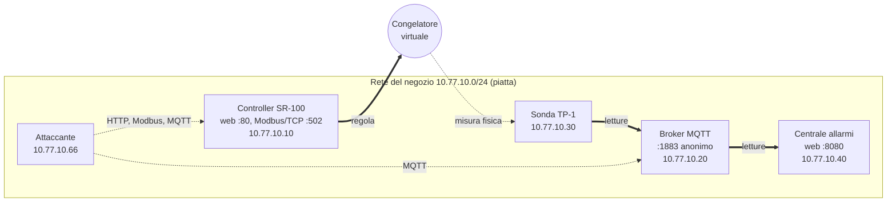

# Threat model del banco di prova

Versione 1.0, 23 novembre 2026. Riferito al banco vulnerabile (`vulnerable/`).

## 1. Scopo e perimetro

Il documento descrive cosa va protetto in un impianto di refrigerazione commerciale connesso, chi lo può attaccare, da dove e con quali effetti. È la base per i tre scenari d'attacco del banco vulnerabile e per le contromisure del banco protetto.

Il modello parte dal caso reale descritto nel [case study](../case-study/case_study.pdf): supervisori di refrigerazione raggiungibili dalla rete, modificati usando le loro funzioni previste. Il banco non riproduce un prodotto commerciale ma la **classe di debolezza**: funzioni di gestione esposte e non protette.

Fuori perimetro: vulnerabilità del firmware di prodotti reali, attacchi fisici all'impianto, attacchi al personale (phishing, ingegneria sociale), negazione del servizio per saturazione della rete.

## 2. Il sistema modellato

| Componente | Ruolo | Interfacce | Corrispondente nel caso reale |
|---|---|---|---|
| Controller SR-100 | Regola il congelatore: setpoint, termostato, sbrinamento | Web (HTTP 80), Modbus/TCP (502) | Supervisore di impianto con interfaccia web |
| Congelatore virtuale | Modello fisico: dispersioni, compressore, resistenza di sbrinamento | Nessuna, è il "mondo fisico" | Banchi e celle frigorifere |
| Sonda TP-1 | Misura la temperatura e la pubblica | MQTT (client), topic di configurazione remota | Sonde e moduli di telemetria |
| Broker MQTT | Smista i messaggi tra sonda e centrale | MQTT (1883) | Infrastruttura di telemetria |
| Centrale allarmi | Genera l'allarme di temperatura alta | MQTT (client), web (8080) | Sistema di allarme del supervisore o del manutentore |

Il congelatore è simulato con un modello del primo ordine accelerato di 60 volte: un secondo reale vale un minuto di impianto. In condizioni normali la temperatura oscilla attorno a -20 °C e uno sbrinamento programmato ogni 6 ore simulate la porta per poco attorno a -13 °C. La centrale dà l'allarme quando la temperatura supera -10 °C per 3 letture consecutive.

## 3. Asset e priorità

In un sistema OT l'ordine delle priorità non è quello dell'IT. Viene prima la **safety**, poi la **disponibilità** del processo, poi l'**integrità** di comandi e misure, per ultima la **riservatezza**.

| Asset | Perché conta | Proprietà prioritaria | Danno se compromesso |
|---|---|---|---|
| Merce nel congelatore | È il valore economico e sanitario protetto dall'impianto | Safety, disponibilità | Merce da buttare, rischio per la salute se venduta |
| Parametri di controllo (setpoint, durata e temperatura di sbrinamento) | Determinano la temperatura reale | Integrità | Riscaldamento del banco, nel caso reale fino a circa 50 °C e principi d'incendio |
| Misure di temperatura | Sono l'unica vista che l'operatore ha del processo | Integrità, disponibilità | L'attacco resta invisibile fino al mattino |
| Funzione d'allarme | È l'ultima barriera prima del danno | Disponibilità, integrità | Il danno non viene fermato in tempo |
| Configurazione della sonda | Decide se e quanto spesso la sonda trasmette | Integrità | Silenziamento della misura |
| Dati di processo (valori, topic, modelli) | Rivelano struttura e versioni dell'impianto | Riservatezza (bassa) | Facilitano la ricognizione, non causano danno diretto |

## 4. Attaccanti

| Profilo | Capacità | Obiettivo | Nel caso reale | Considerato nel banco |
|---|---|---|---|---|
| Opportunistico da Internet | Bassa o media. Motori di ricerca di dispositivi, credenziali di fabbrica, script generici | Danno visibile e propaganda, bersagli scelti tra i meno protetti | Entrambe le ondate, con identità hacktiviste | Sì, è il profilo principale |
| Attore statale sotto identità hacktivista | Alta, ma usa tecniche semplici se bastano | Pressione politica sotto la soglia della guerra | Attribuzione francese della prima ondata all'unità Shahid Kaveh dell'IRGC | Sì, stesse tecniche del precedente |
| Manutentore compromesso (supply chain) | Accesso remoto legittimo all'impianto | Nessuno in proprio, è il canale usato da altri | Ipotesi per l'EFS, attacco passato da un fornitore | Sì, come punto d'ingresso nella rete |
| Insider nel negozio | Accesso fisico e alla rete locale | Sabotaggio, frode | Non osservato | No, fuori perimetro |

**Ipotesi di lavoro.** L'attaccante raggiunge la rete del negozio, perché l'impianto è esposto su Internet come nel caso reale o perché è entrato dall'accesso remoto di un manutentore. Non ha accesso fisico, non conosce credenziali e non usa vulnerabilità del software. Nel banco questa condizione è rappresentata dal container `attacker` sulla stessa rete dei dispositivi.

## 5. Superficie d'attacco

| Punto d'ingresso | Protocollo e porta | Debolezza nella versione vulnerabile | CWE |
|---|---|---|---|
| Interfaccia web del controller | HTTP, 80 | Nessuna autenticazione per modificare i parametri | CWE-306 |
| | | Nessun limite di plausibilità sui valori (setpoint di +50 °C accettato) | CWE-20 |
| | | Traffico in chiaro, banner con modello e versione | CWE-319, CWE-200 |
| Server Modbus/TCP del controller | Modbus/TCP, 502 | Il protocollo non prevede autenticazione: chi raggiunge la porta scrive i registri | CWE-306 |
| Broker MQTT | MQTT, 1883 | Accesso anonimo, nessuna ACL: chiunque legge e pubblica su ogni topic | CWE-306, CWE-284 |
| | | Traffico in chiaro | CWE-319 |
| Letture della sonda | MQTT, topic `store/freezer1/temperature` | Nessuna firma: la centrale non distingue una lettura vera da una falsa | CWE-345 |
| | | Timestamp e numero di sequenza presenti ma non verificati | CWE-294 |
| Configurazione remota della sonda | MQTT, topic `store/freezer1/probe1/config` | Comandi accettati da chiunque | CWE-306 |
| | | Il messaggio di presentazione "retained" rivela il topic di configurazione | CWE-200 |
| Centrale allarmi | MQTT e HTTP, 8080 | Nessun heartbeat: l'assenza di letture non genera allarmi | CWE-693 |
| Rete | Tutte | Rete piatta: dispositivi di controllo, telemetria e postazioni nello stesso segmento | Nessun CWE specifico, vedi nota |

Nota. La segmentazione di rete non ha un CWE specifico. Nella relazione la si descrive con zone e conduit secondo IEC 62443.

### Sintesi STRIDE

| Componente | S | T | R | I | D | E |
|---|---|---|---|---|---|---|
| Controller | Chiunque si presenta come operatore | Parametri modificati | Le modifiche registrano solo indirizzo IP o "modbus" | Modello e versione esposti | Sbrinamento forzato blocca il raffreddamento | Nessun ruolo: ogni client è amministratore |
| Sonda | Letture inventate con il suo identificativo | Configurazione modificata | Nessun registro di chi ha cambiato la configurazione | Topic e configurazione pubblici | Invio spento da remoto | |
| Broker | Client anonimi | Messaggi iniettati o ripetuti | Nessun registro applicativo | Tutti i topic leggibili | | Nessuna ACL |
| Centrale allarmi | Accetta letture da chiunque | Stato d'allarme falsato | | | Allarme mai generato | |

## 6. Scenari d'attacco

Ogni scenario usa solo funzioni previste dai dispositivi. Gli script sono in `vulnerable/attacker/attacks/`.

### 6.0 Ricognizione

**Obiettivo.** Scoprire quali dispositivi ci sono, cosa espongono e come si controllano.

**Passi.** `scan.sh` trova gli host attivi, le porte aperte, il titolo e il banner delle pagine web, i topic MQTT con i rispettivi messaggi. `recon_modbus.py` legge l'identificativo del dispositivo Modbus e i primi registri.

**Cosa si ottiene.** Modello e firmware del controller (dal banner HTTP e dall'identificativo Modbus), il formato delle letture, il topic di configurazione della sonda. È l'equivalente in laboratorio di quello che i motori di ricerca di dispositivi hanno fatto su Internet nel caso reale.

| Tattica | Tecnica | ID |
|---|---|---|
| Discovery | Remote System Discovery: Port Scan | T0846.001 |
| Discovery | Remote System Information Discovery | T0888 |
| Collection | Point & Tag Identification | T0861 |
| Collection | Monitor Process State | T0801 |

### 6.1 Scenario 1: modifica del setpoint e sbrinamento forzato

**Obiettivo.** Riscaldare il congelatore.

**Precondizioni.** Raggiungere la porta 80 o la porta 502 del controller.

**Passi.**
- Variante web: una richiesta POST al modulo dei parametri porta il setpoint a +25 °C. Il compressore si ferma.
- Variante Modbus: una scrittura di due registri (function code 16) imposta uno sbrinamento di 480 minuti con fine a 50 °C, una scrittura singola (function code 6) lo avvia. È la stessa azione osservata nel caso reale, con sbrinamenti di 8 ore attorno a 50 °C.

**Effetto atteso sul banco.** Con il setpoint a +25 °C la temperatura supera -10 °C in circa 90 secondi reali e la centrale dà l'allarme. Con lo sbrinamento forzato sale di circa 3 °C ogni 10 secondi reali fino a 50 °C.

**Lettura.** Da solo l'attacco viene scoperto: la sonda e la centrale funzionano. È per questo che gli scenari 2 e 3 esistono.

| Tattica | Tecnica | ID |
|---|---|---|
| Initial Access | Internet Accessible Device (nel caso reale) | T0883 |
| Execution | Graphical User Interface (variante web) | T0823 |
| Impair Process Control | Unauthorized Message: Command Message (variante Modbus) | T1692.001 |
| Impair Process Control | Modify Parameter | T0836 |
| Impact | Manipulation of Control | T0831 |
| Impact | Damage to Property | T0879 |
| Impact | Loss of Productivity and Revenue | T0828 |

### 6.2 Scenario 2: letture falsificate o ripetute

**Obiettivo.** Far vedere alla centrale una temperatura normale mentre il congelatore si scalda.

**Precondizioni.** Raggiungere il broker. Non servono credenziali.

**Passi.**
- Falsificazione: pubblicare letture inventate a -20 °C sul topic della sonda, quattro al secondo.
- Replay: registrare per 20 o 30 secondi le letture autentiche e ripeterle identiche in ciclo, quattro al secondo.

In entrambi i casi la sonda vera continua a trasmettere ogni 2 secondi. Le letture dell'attaccante sono più frequenti e si inseriscono tra quelle vere, che non riescono più a formare 3 letture consecutive sopra soglia.

**Effetto atteso sul banco.** Combinato con lo scenario 1, la temperatura reale supera -10 °C ma la centrale resta su "NORMALE" e mostra circa -20 °C. Quando l'attaccante smette, le letture vere tornano a prevalere e l'allarme scatta.

**Lettura.** Il replay è più insidioso della falsificazione: i messaggi sono autentici, con valori, rumore e identificativo veri. Una firma digitale da sola non lo ferma, serve anche il controllo di timestamp o numero di sequenza. Nel banco vulnerabile entrambi i campi sono già nel messaggio, ma nessuno li controlla: durante l'attacco il numero di sequenza torna indietro o salta a valori assurdi.

| Tattica | Tecnica | ID |
|---|---|---|
| Collection | Monitor Process State (registrazione delle letture) | T0801 |
| Collection | Adversary-in-the-Middle (posizione equivalente, ottenuta tramite il broker aperto) | T0830 |
| Impair Process Control, Evasion | Unauthorized Message: Reporting Message | T1692.002 |
| Impact | Manipulation of View | T0832 |

### 6.3 Scenario 3: silenziamento della sonda

**Obiettivo.** Impedire che arrivino misure, così che nessun allarme possa scattare.

**Precondizioni.** Raggiungere il broker.

**Passi.** Leggere il messaggio di presentazione della sonda, che indica il topic di configurazione. Pubblicare su quel topic `{"enabled": false}`. La sonda resta connessa ma smette di trasmettere.

**Effetto atteso sul banco.** Combinato con lo scenario 1, la temperatura reale supera -10 °C. La centrale resta su "NORMALE" con l'ultima lettura ricevuta prima del silenziamento. L'età dell'ultima lettura cresce ed è visibile in pagina, ma non genera allarmi.

**Lettura.** Nel caso reale gli attaccanti hanno modificato anche le soglie d'allarme. Il risultato è lo stesso: l'allarme non arriva. All'EFS ha funzionato un monitoraggio indipendente dal sistema attaccato. Nel banco protetto lo stesso ruolo lo avranno l'heartbeat e una seconda sonda su un canale separato.

| Tattica | Tecnica | ID |
|---|---|---|
| Impair Process Control | Unauthorized Message: Command Message (comando di configurazione) | T1692.001 |
| Inhibit Response Function | Alarm Suppression | T0878 |
| Impact | Loss of View | T0829 |

### 6.4 Catena completa

Ricognizione, poi silenziamento della sonda o replay delle letture, infine modifica dei parametri. È la sequenza che il banco protetto deve interrompere in più punti.

## 7. Mappatura MITRE ATT&CK for ICS

Matrice ATT&CK for ICS, contenuto versione 20.1, consultata il 23 novembre 2026. Nella versione 20 i messaggi non autorizzati sono raccolti nella tecnica T1692, Unauthorized Message, con due sotto-tecniche: Command Message (T1692.001) e Reporting Message (T1692.002). Le versioni precedenti usavano gli identificativi T0855, Unauthorized Command Message, e T0856, Spoof Reporting Message.

| Tattica | Tecnica | ID | Ricognizione | Scen. 1 | Scen. 2 | Scen. 3 | Caso reale |
|---|---|---|---|---|---|---|---|
| Initial Access | Internet Accessible Device | T0883 | | | | | x |
| Execution | Graphical User Interface | T0823 | | x | | | x |
| Discovery | Remote System Discovery: Port Scan | T0846.001 | x | | | | |
| Discovery | Remote System Information Discovery | T0888 | x | | | | |
| Collection | Point & Tag Identification | T0861 | x | | | | |
| Collection | Monitor Process State | T0801 | x | | x | | |
| Collection | Adversary-in-the-Middle | T0830 | | | x | | |
| Impair Process Control | Modify Parameter | T0836 | | x | | | x |
| Impair Process Control | Unauthorized Message: Command Message | T1692.001 | | x | | x | |
| Impair Process Control, Evasion | Unauthorized Message: Reporting Message | T1692.002 | | | x | | |
| Inhibit Response Function | Alarm Suppression | T0878 | | | | x | |
| Inhibit Response Function | Modify Alarm Settings | T0838 | | | | | x |
| Impact | Manipulation of Control | T0831 | | x | | | x |
| Impact | Manipulation of View | T0832 | | | x | | |
| Impact | Loss of View | T0829 | | | | x | |
| Impact | Damage to Property | T0879 | | x | | | x |
| Impact | Loss of Productivity and Revenue | T0828 | | x | | | x |

Internet Accessible Device (T0883) è il punto di partenza del caso reale. Nel banco la stessa condizione è un'ipotesi di lavoro (paragrafo 4): l'attaccante è già sulla rete dei dispositivi.

Modify Alarm Settings (T0838), osservata nel caso reale, non è riprodotta: nel banco le soglie d'allarme non sono modificabili da remoto. Lo scenario 3 ottiene lo stesso effetto per un'altra via.

## 8. Valutazione del rischio

Scala qualitativa. Probabilità: quanto è facile per l'attaccante del paragrafo 4. Impatto: danno sull'asset più importante coinvolto.

| Scenario | Probabilità | Impatto | Rischio | Motivo |
|---|---|---|---|---|
| 1. Modifica dei parametri | Alta | Alto | Alto | Una sola richiesta, nessuna credenziale. Danno fisico diretto |
| 2. Letture falsificate o ripetute | Alta | Alto se combinato con lo scenario 1 | Alto | Broker anonimo. Da solo nasconde, non danneggia |
| 3. Silenziamento della sonda | Alta | Alto se combinato con lo scenario 1 | Alto | Un messaggio. Toglie l'ultima barriera |
| Ricognizione | Molto alta | Basso | Medio | Non danneggia, ma rende gli altri scenari immediati |

## 9. Contromisure previste nel banco protetto

| Debolezza | Contromisura | Scenari interrotti |
|---|---|---|
| Dispositivi raggiungibili da chiunque | Segmentazione: rete di controllo separata da quella del negozio, firewall, accesso del manutentore solo via VPN WireGuard | Tutti, a monte |
| Interfaccia web senza autenticazione | Login con credenziali uniche, limiti di plausibilità sui parametri | 1 |
| Modbus/TCP aperto | Porta raggiungibile solo dal segmento di controllo, scritture solo da indirizzi autorizzati | 1 |
| Broker anonimo e in chiaro | Autenticazione, ACL per topic, TLS | 2, 3 |
| Letture non verificabili | Letture firmate con timestamp e numero di sequenza controllati: un messaggio ripetuto viene scartato | 2 |
| Configurazione remota della sonda senza controllo | Topic di configurazione scrivibile solo dal manutentore autenticato | 3 |
| Nessun heartbeat | L'assenza di letture oltre un intervallo genera un allarme | 3 |
| Un solo canale di misura | Seconda sonda su Arduino, collegata via USB e fuori dalla rete | 2, 3 |
| Attacco scoperto solo al mattino | Rilevamento di anomalie fisiche: setpoint cambiati fuori orario, sbrinamenti non programmati, curve di temperatura impossibili | 1, 2 |

## Riferimenti

- Case study del progetto: [case-study/case_study.pdf](../case-study/case_study.pdf).
- MITRE ATT&CK for ICS, matrice v20.1: https://attack.mitre.org/matrices/ics/
- MITRE CWE: https://cwe.mitre.org/
- OASIS, MQTT Version 3.1.1 e 5.0.
- Modbus Organization, Modbus Application Protocol Specification V1.1b3.
